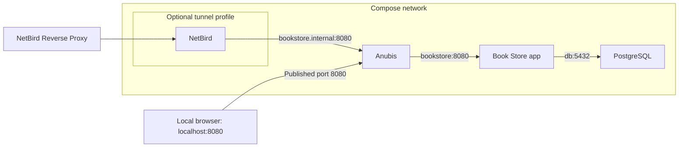

# Book Store Service


A bookstore app built with Spring Boot and Thymeleaf for practice. Customers browse the catalog and place orders from their basket. Staff manage the catalog, confirm orders, and can block customer accounts.

## Contents

- [Build](#build)
- [Configure `.env`](#configure-env)
- [Run locally](#run-locally)
- [Run with Podman Compose](#run-with-podman-compose)
- [Compose diagram](#compose-diagram)
- [License and author](#license-and-author)

## Build

You’ll need JDK 17 and Bun. The Gradle Wrapper downloads Gradle for you.

```sh
bun install --frozen-lockfile
bun run build:css
./gradlew bootJar
```

Build the Tailwind stylesheet with `build:css` before packaging. Gradle does not generate it. The executable JAR is `build/libs/bookstore-0.0.1.jar`.

Run `./gradlew test` to test against in-memory H2. You don’t need Bun, PostgreSQL, or a `.env` file for this.

## Configure `.env`

Copy the template in the repository root:

```sh
cp .env.example .env
```

| Variable | Value |
| --- | --- |
| `JWT_SECRET` | A random secret of at least 32 bytes. Generate one with `openssl rand -hex 32`. |
| `spring.flyway.placeholders.employeehash` (local) or `SPRING_FLYWAY_PLACEHOLDERS_EMPLOYEEHASH` (Compose) | The BCrypt password hash for `employee@bookstore.local`. Flyway needs it even with H2. |
| `DB_USERNAME`, `DB_PASSWORD`, `DB_DATABASE` | The PostgreSQL user, password, and database name. Leave the template values unchanged if you only use H2. |
| `DB_PORT` | The PostgreSQL port for a local run with the `postgres` profile. Defaults to `5432`. |
| `JWT_COOKIE_SECURE` | Leave this set to `false` for local HTTP. Set it to `true` when serving the application over HTTPS. |

Run `htpasswd -nBC 12 employee` and enter the password you want to use. Copy the hash after `employee:`. For a local run, replace the template’s hash setting with `spring.flyway.placeholders.employeehash` and leave the hash unquoted. For Compose, keep `SPRING_FLYWAY_PLACEHOLDERS_EMPLOYEEHASH` and wrap the hash in single quotes. Sign in as `employee@bookstore.local` with the password you entered. Once Flyway has applied the migration, editing `.env` won’t change that password.

## Run locally

After building the CSS, run this from the repository root:

```sh
./gradlew bootRun
```

Spring reads `.env` automatically. If you built the JAR, you can also run `java -jar build/libs/bookstore-0.0.1.jar` from the repository root.

Open <http://localhost:8080>. By default, the app uses in-memory H2 and loses its data when it stops.

To use an existing PostgreSQL server, fill in the `DB_*` variables in `.env`. Set `DB_HOST` if the server is not on `localhost`, then run:

```sh
./gradlew bootRun --args='--spring.profiles.active=postgres'
```

## Run with Podman Compose

Install Podman and a Compose provider such as `podman-compose`. Fill in `.env`, then run:

```sh
podman compose up --build -d
```

The container build handles the CSS and JAR, so you don’t need JDK or Bun on the host. Compose starts PostgreSQL. Open <http://localhost:8080> to reach the app through Anubis.

To follow the application logs:

```sh
podman compose logs -f bookstore
```

Use `podman compose down` to stop the stack. PostgreSQL data stays in the named volume.

## Compose diagram



To enable the NetBird entry point, set `NB_SETUP_KEY` in `.env` and run `podman compose --profile tunnel up -d`. Configure the NetBird Reverse Proxy separately to reach `bookstore.internal:8080` through the NetBird container.

From the host, use `localhost:8080` to reach Anubis. The Compose port mapping is not limited to the loopback interface.

## License and author

Copyright (c) 2026 [tevarindol](https://github.com/tevarindol) (`tevarindol@proton.me`). All rights reserved.

This project is proprietary. Unauthorized copying, transfer, or reproduction is prohibited. See [LICENSE](LICENSE) for the full terms.
